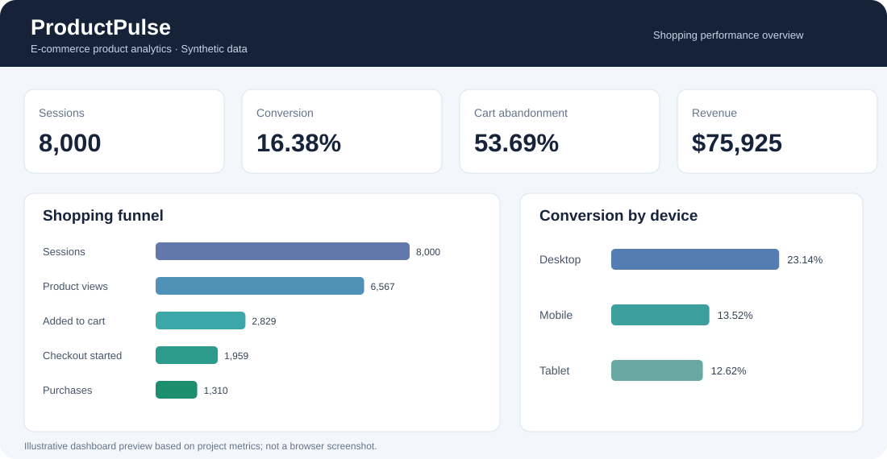

# ProductPulse — E-commerce Product Analytics & Growth Strategy

**ProductPulse** is an independent product analytics case study exploring how an e-commerce team could identify checkout friction, evaluate customer segments, and prioritize product experiments.

The project combines **SQL and Python analysis**, an **interactive HTML dashboard**, and a **product strategy report** built around a synthetic dataset of 8,000 shopping sessions.

## Dashboard preview



**[Open dashboard demo](https://dsharma0323.github.io/productPulse/)** · [View dashboard source](dashboard/index.html)

The dashboard is configured for deployment through GitHub Pages. If the live link is not active yet, enable **Settings → Pages → Build and deployment → Source: GitHub Actions**, then run the **Deploy ProductPulse dashboard to GitHub Pages** workflow from the Actions tab.

## Business question

Where do shoppers leave the purchase funnel, how does conversion differ by device, and which product improvements would be most useful to investigate first?

## Dashboard and analysis

Open [the interactive dashboard](dashboard/index.html) locally to explore:

- Shopping funnel: sessions → product views → carts → checkout starts → purchases
- Purchase conversion and cart abandonment
- Revenue and customer segments
- Mobile versus desktop conversion

The dashboard also runs locally in a browser; the GitHub Pages workflow publishes the same HTML dashboard.

## Key findings

| Metric | Simulated result |
| --- | ---: |
| Shopping sessions | 8,000 |
| Product views | 6,567 |
| Add-to-cart sessions | 2,829 |
| Checkout starts | 1,959 |
| Purchases | 1,310 |
| Purchase conversion rate | 16.38% |
| Cart abandonment rate | 53.69% |
| Revenue | $75,925.05 |
| Mobile conversion rate | 13.52% |
| Desktop conversion rate | 23.14% |

**Interpretation:** The synthetic funnel shows substantial drop-off between adding an item to the cart and purchasing. Mobile conversion is lower than desktop conversion in this dataset. These patterns suggest questions for product research; they do **not** establish the reasons for drop-off or prove that a redesign would help.

## Product recommendations

The accompanying [strategy case study](reports/product_strategy.md) outlines three hypotheses:

1. **Simplify mobile checkout** to explore whether fewer steps improve completion.
2. **Show total costs earlier** to reduce uncertainty about shipping and fees.
3. **Clarify coupon eligibility** to help shoppers understand applicable promotions.

The proposals are compared using an **illustrative RICE framework** (Reach × Impact × Confidence ÷ Effort). The recommended next steps are usability research, prototyping, and controlled A/B testing—not an immediate claim of revenue lift.

## Tools and methodology

- **SQL / SQLite:** Query funnel activity, purchase conversion, and segments.
- **Python:** Independently calculate and validate key performance indicators.
- **HTML / JavaScript:** Present interactive dashboard charts and filters.
- **Product strategy:** Form hypotheses, prioritize features, and define experiment metrics.

Each row in `data/sessions.csv` represents one **simulated shopping session**, not necessarily a unique customer. Funnel-stage fields are binary and nested, and `revenue_usd` is zero for non-purchase sessions.

## Run locally

1. Clone the repository:
   ```bash
   git clone https://github.com/dsharma0323/productPulse.git
   cd productPulse
   ```
2. Open `dashboard/index.html` in a web browser to explore the offline dashboard.
3. Run the Python KPI check:
   ```bash
   python3 python/analyze_data.py
   ```
4. Optionally use SQLite to run queries from `sql/product_analysis.sql` against `data/productpulse.db`.

The Python analysis uses the standard library and does not require additional packages.

## Repository structure

```text
dashboard/                 Interactive HTML dashboard
data/                      Synthetic CSV, SQLite database, and metrics
python/analyze_data.py     KPI validation
sql/product_analysis.sql   SQL analysis queries
reports/                   Product strategy case study (Markdown and PDF)
assets/                    Dashboard preview graphic
.github/workflows/         GitHub Pages deployment configuration
README.md                  Project overview and setup
```

## Scope and limitations

This is a **portfolio case study using synthetic, AI-assisted data**. AI also assisted with code implementation and documentation. The metrics are not real company results, and no confidential customer data was used.

No customer interviews, live experiments, or measured revenue improvements were conducted. Business impact calculations in the strategy report are illustrative scenarios rather than forecasts or observed outcomes.
